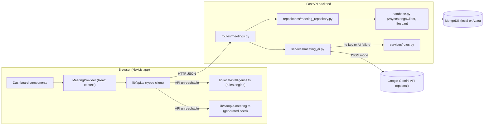
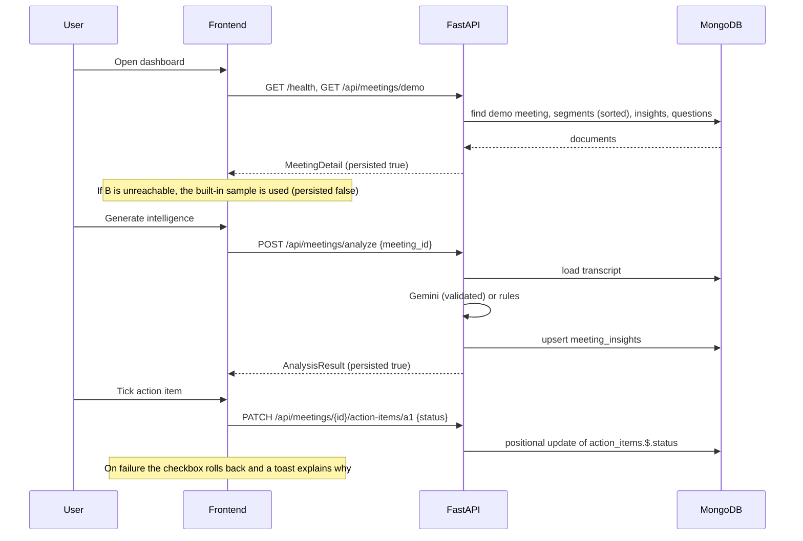

# Architecture

BridgeTalk is a Next.js dashboard backed by a FastAPI service that stores meetings, transcripts, insights and Q&A history in MongoDB. Intelligence has three tiers: Gemini if configured, then a rules engine on the backend, then the same rules engine in the browser. Storage has two modes: **MongoDB** (saved) and **demo mode** (built-in sample, nothing saved).

## Diagram

## Responsibilities

**Frontend (`frontend/`)**
- Renders the app shell and five routes: `/`, `/meetings`, `/decisions`, `/action-items` and `/settings`. All are statically prerendered client UIs.
- `components/providers/MeetingProvider.tsx` holds session state and loads the meeting with its saved insights, completed items and Q&A history. It tracks `storageMode` (`"mongodb"` or `"demo"`).
- `lib/api.ts` references stored meetings by `meeting_id`. It sends the built-in sample inline, so that is stateless and not saved. It falls back to the in-browser engine when the API is unreachable.
- The header shows **Saved to MongoDB** or **Demo mode · not saved**, and toasts say whether each result was saved.

**Backend (`backend/`)**
- `config.py`: pydantic-settings for the MongoDB, Gemini and CORS settings.
- `database.py`: one shared `AsyncMongoClient`, created in the FastAPI lifespan. It is verified with a ping, creates indexes and seeds the demo meeting, retries while MongoDB is down, and is closed on shutdown.
- `repositories/meeting_repository.py`: every MongoDB read and write, and the conversion between ObjectIds and string IDs.
- `routes/meetings.py`: HTTP handlers. They validate IDs, choose between the stored and stateless paths, and run the blocking AI or rules code in a thread pool.
- `services/meeting_ai.py` and `services/rules.py`: intelligence. They have no database access.

## Data flow

## Startup and lifecycle

1. The lifespan creates `MongoState` and calls `connect()`. It builds `AsyncMongoClient` (3-second server selection and connect timeouts), pings, runs `create_indexes()` and `ensure_demo_meeting()`.
2. If that fails, the API still starts in fallback mode. Requests that need the database retry `connect()` at most once every 15 seconds, so starting MongoDB later works without restarting the API.
3. On shutdown the client is closed.

Details are in [DATABASE.md](DATABASE.md).

## AI integration and fallback strategy

- `services/meeting_ai.py` reads `GEMINI_API_KEY` and `GEMINI_MODEL` from settings and creates the Gemini client lazily. It uses a 20-second timeout, one retry, `temperature=0` and `response_format={"type": "json_object"}`.
- After parsing, the response is validated with Pydantic models, then sanitised:
  - Segment IDs that don't exist in the transcript are removed, and any item left with no valid source is dropped.
  - An owner is kept only if it matches a real speaker; otherwise it becomes `null`.
  - A Q&A answer marked grounded but with no valid sources becomes "not enough information".
- Any AI exception is logged by class name only, and the rules engine answers instead.
- `rules.py` and `frontend/lib/local-intelligence.ts` implement the same logic. Both use generic segment IDs, so they work with the sample's `s1…` IDs and with MongoDB ObjectId strings.

| Output | Rule |
|---|---|
| Decisions | Sentences with "let's decide", "decided" or "agreed" (not questions). If the sentence is only a confirmation, the decision is the rest of the segment and the preceding question is cited too. |
| Action items | "I will / I'll …" makes the speaker the owner. "Someone needs to …" gives an unassigned item. A deadline is set only from explicit phrases such as "by Friday". |
| Open questions | A question whose reply says "don't have an answer", "keep … open" and so on, or that gets no reply |
| Q&A | Detects the question type, otherwise ranks segments by keyword relevance (IDF-weighted). "When" questions need a date or time phrase in the matching segment. |

## Data structures

The API models are in `frontend/types/meeting.ts` and `backend/app/schemas.py`. `MeetingDetail` is `Meeting` plus `persisted`, `insights` and `questions`. The MongoDB document schemas are in [DATABASE.md](DATABASE.md).

The seed meeting is written once in Python (`backend/app/data/sample_meeting.py`). The same data is seeded into MongoDB and exported to `frontend/lib/sample-meeting.ts` for the offline fallback.

## Error handling

| Failure | Behaviour |
|---|---|
| Backend unreachable | The built-in sample and in-browser engine are used, with "Offline" toasts and the "Demo mode · not saved" indicator |
| MongoDB unreachable | `/health` reports `degraded`; `/demo` serves the sample with `persisted: false`; writes and stored reads return 503 "Nothing was saved" |
| Database error mid-request | `PyMongoError` gives a 503, logged by class name only |
| Invalid ObjectId, unknown record | 422 `invalid_id`, 404 `not_found` |
| Invalid body | 422 with field names and messages only |
| AI failure or malformed output | Logged by class name; the rules engine answers |
| Saving an action item fails | The checkbox rolls back and a warning toast shows the reason |
| Unhandled error | 500 with a generic message; the trace goes to the server log only |

## Security considerations

- `MONGODB_URI` and `GEMINI_API_KEY` are `SecretStr` settings, read only on the server. They are never logged, returned or sent to the browser.
- Database and driver errors are reduced to `database_unavailable` before reaching the client.
- ObjectIds are validated before any query, and query values come from validated models, so request bodies can't inject operators.
- CORS allows a single origin (`FRONTEND_ORIGIN`), the `GET`, `POST` and `PATCH` methods, and the `Content-Type` header.
- Request sizes are capped: 500 segments, 50 speakers, 500-character questions, and the Q&A history is limited to 100 entries.
- `.env` files are ignored by git, and only `.env.example` files are committed.
- Model output is treated as untrusted. It is validated and filtered, and React escapes it when rendering.
