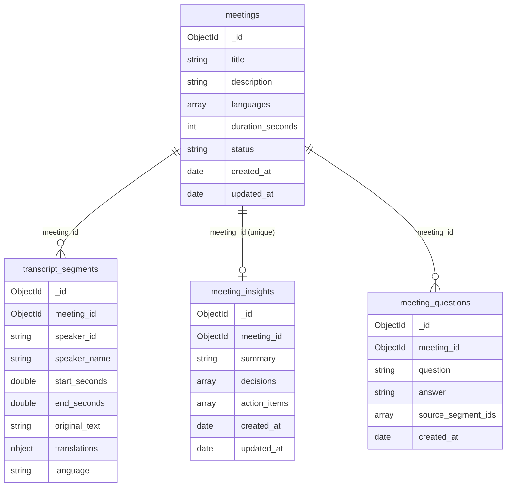

# Database

BridgeTalk stores meetings, transcripts, generated insights and Q&A history in MongoDB through PyMongo's async API (`AsyncMongoClient`, PyMongo 4.13 or newer). Motor is not used. If MongoDB is unreachable, the app keeps working in a clearly labelled demo mode and saves nothing.

## Collections and relationships



- A meeting has many transcript segments, at most one insights document (upserted on every analysis), and many saved questions.
- Insights and questions refer to transcript lines through `source_segment_ids`, which are segment `_id` values as strings. The transcript is never copied into insights or questions.

### `meetings`

| Field | Type | Notes |
|---|---|---|
| `_id` | ObjectId | Returned to the API as the string `id` |
| `title`, `description` | string | |
| `languages` | array of `{code, label, native_label}` | Languages the meeting can be displayed in |
| `duration_seconds` | int | |
| `status` | `"scheduled"`, `"live"` or `"completed"` | |
| `created_at`, `updated_at` | date (UTC) | |
| `speakers` | array of `{id, name, role, primary_language}` | Extra field; the UI needs speaker roles and languages |
| `date`, `is_simulated`, `source_note` | string, bool, string | Extra fields carried over from the existing API contract |
| `seed_key` | string, optional | Present only on seeded records (`"lumen-beta-sync"`); used to seed exactly once |

### `transcript_segments`

| Field | Type | Notes |
|---|---|---|
| `_id` | ObjectId | Used as the segment `id` in API responses and citations |
| `meeting_id` | ObjectId | References `meetings._id` |
| `speaker_id`, `speaker_name` | string | `speaker_name` is copied for convenience |
| `start_seconds`, `end_seconds` | double | |
| `language` | `"en"`, `"bn"` or `"hi"` | The original spoken language |
| `original_text` | string | The text in `language` |
| `translations` | object keyed by language | Other languages only, for example `{"en": "I will fix the two payment bugs by Friday.", "hi": "मैं शुक्रवार तक …"}` |

The API merges these back into the existing shape: `text = {...translations, [language]: original_text}`.

### `meeting_insights`

| Field | Type | Notes |
|---|---|---|
| `_id` | ObjectId | |
| `meeting_id` | ObjectId | Unique: one insights document per meeting |
| `summary` | string | |
| `decisions` | array of `{text, source_segment_ids}` | |
| `action_items` | array of `{id, task, owner, deadline, status, source_segment_ids}` | `id` is `"a1"`, `"a2"` and so on within the meeting; `owner` and `deadline` are null unless stated; `status` is `"pending"` or `"done"` |
| `open_questions` | array of `{text, source_segment_ids}` | Extra field |
| `mode` | `"gemini"` or `"rules"` | Extra field: which engine produced it |
| `created_at`, `updated_at` | date | `created_at` is set on first insert only |

When a meeting is analysed again, the insights document is upserted. Action items marked `done` keep that status if the same task text is regenerated.

### `meeting_questions`

| Field | Type | Notes |
|---|---|---|
| `_id` | ObjectId | |
| `meeting_id` | ObjectId | |
| `question`, `answer` | string | |
| `source_segment_ids` | array of string | Segment IDs that support the answer (or related context when not grounded) |
| `grounded`, `mode` | bool, string | Extra fields so the UI can restore its badges |
| `created_at` | date | |

## Indexes

They are created at startup by `create_indexes()` in `app/database.py`. Creation is idempotent, so restarts are safe.

| Collection | Index | Purpose |
|---|---|---|
| `meetings` | `{seed_key: 1}`, unique and sparse | Seed the demo meeting exactly once, even with concurrent starts |
| `meetings` | `{created_at: -1}` | `GET /api/meetings` ordering |
| `transcript_segments` | `{meeting_id: 1, start_seconds: 1}` | Load a meeting's transcript in timestamp order |
| `meeting_insights` | `{meeting_id: 1}`, unique | Look up and upsert one insights document per meeting |
| `meeting_questions` | `{meeting_id: 1, created_at: 1}` | Q&A history in order |

## Environment configuration

These are read by `app/config.py` (pydantic-settings) from the environment or `backend/.env`.

| Variable | Default | Notes |
|---|---|---|
| `MONGODB_URI` | `mongodb://localhost:27017` | Local server or Atlas `mongodb+srv://…`. Stored as a secret and never logged or returned. |
| `MONGODB_DATABASE` | `bridgetalk` | |
| `MONGODB_TIMEOUT_MS` | `3000` | Server selection and connect timeout. Keeps startup fast when MongoDB is down. |

## Seed data

- On startup, after a successful ping, `MeetingRepository.ensure_demo_meeting()` checks for a meeting with `seed_key: "lumen-beta-sync"`.
  - If none exists, it inserts the fictional meeting from `app/data/sample_meeting.py` and its 11 segments.
  - If it exists, nothing is changed. Existing meetings, insights and questions are never overwritten. The one repair it makes is to insert segments if a previous seed stopped before writing them.
- `POST /api/meetings/demo/reset` (the **Reset sample** button) deletes only the demo meeting's insights and questions. The meeting and transcript stay.
- The seed is clearly simulated: it is hand-written, has `is_simulated: true`, and is not the output of transcription.

## Local MongoDB setup

Use any one of these:

```bash
# Docker
docker run -d --name bridgetalk-mongo -p 27017:27017 mongo:8

# Windows: install MongoDB Community Server (runs as the "MongoDB" service)
#   https://www.mongodb.com/try/download/community
# macOS (Homebrew)
brew tap mongodb/brew && brew install mongodb-community && brew services start mongodb-community
```

Keep `MONGODB_URI=mongodb://localhost:27017` and restart the backend. The log should say `Connected to MongoDB database 'bridgetalk'`, and `/health` should return `"database": "connected"`.

## MongoDB Atlas setup

1. Create a free cluster at https://cloud.mongodb.com.
2. Under **Database Access**, create a database user. Under **Network Access**, allow your IP address.
3. Click **Connect**, then **Drivers**, and copy the `mongodb+srv://` URI.
4. Put it in `backend/.env` (never commit this file):
   ```
   MONGODB_URI=mongodb+srv://<user>:<password>@<cluster>.mongodb.net/?retryWrites=true&w=majority
   MONGODB_DATABASE=bridgetalk
   ```
   `dnspython`, which `mongodb+srv` needs, is installed as a PyMongo dependency.

## Error handling and persistence guarantees

| Situation | Behaviour |
|---|---|
| MongoDB down at startup | The API still starts. The log shows `MongoDB unavailable (<ErrorClass>); running in demo fallback mode`, and `/health` returns `status: "degraded"`, `database: "unavailable"`. |
| MongoDB comes up later | The next request retries the connection (at most once every 15 seconds), creates indexes and seeds |
| `GET /api/meetings/demo` without a database | Returns the built-in sample with `persisted: false` and its original IDs (`lumen-beta-sync`, `s1`…) |
| A write or a stored-meeting read without a database | `503 {"error": "database_unavailable", "message": "The database is unavailable. Nothing was saved."}` |
| A database error mid-request | Logged by class name only, and returned as the same 503 |
| Malformed ObjectId | `422 {"error": "invalid_id"}` before any database call |
| Unknown meeting or action item | `404 {"error": "not_found"}` |

- `persisted: true` appears on an analysis or answer only after the MongoDB write returned successfully.
- The frontend shows **Saved to MongoDB** or **Demo mode · not saved** in the header.
- If saving an action-item checkbox fails, the frontend rolls it back and shows a toast, rather than pretending the change was saved.
- Connection strings, credentials and driver error messages are never sent to the client.

## Testing without a server

`python -m tests.test_mongo_persistence` (install `requirements-dev.txt` first) runs the real API and repository against `mongomock`, an in-memory stand-in, behind a thin async adapter. It checks seeding, ordering, upserts, positional updates and 404s. It does not test driver or network behaviour; run `python smoke_test.py` against a real MongoDB for that.
